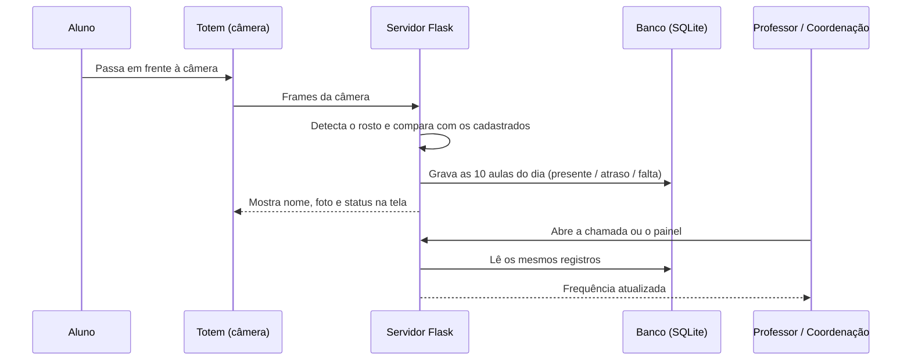
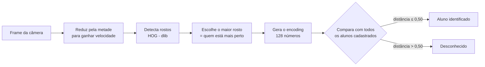
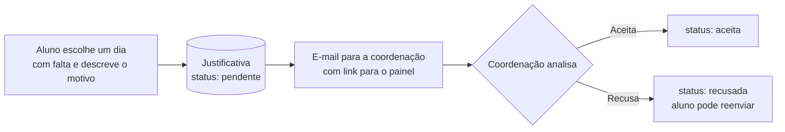
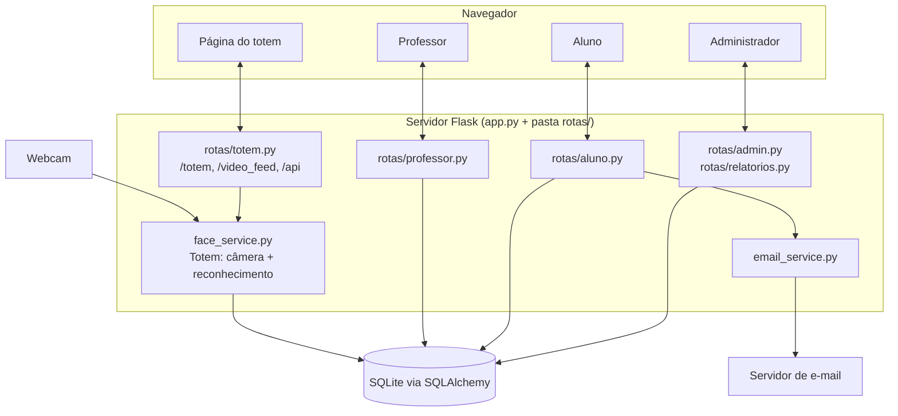
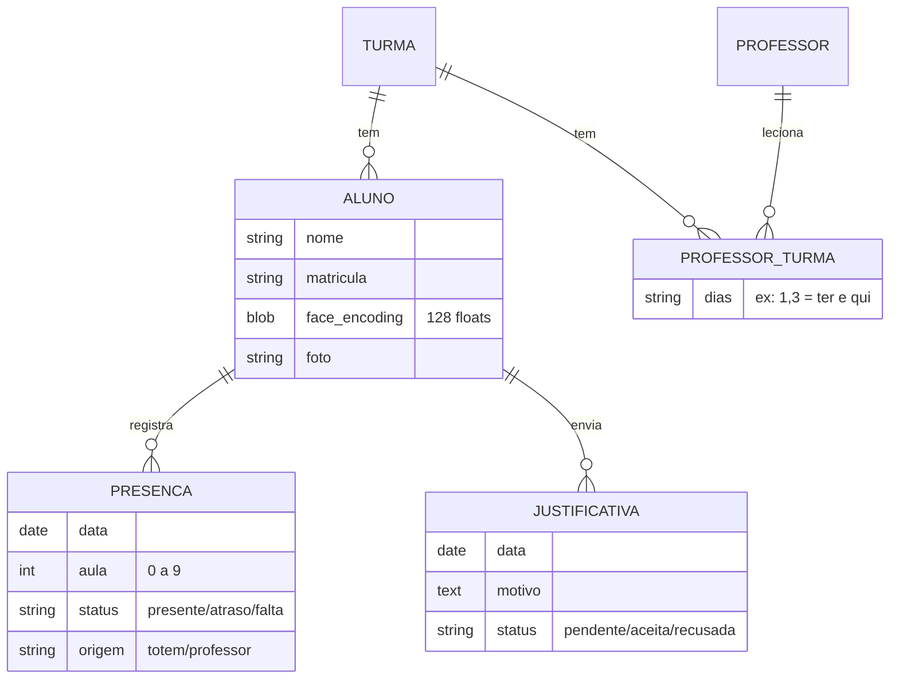

# Sobre o FrequencyON

> Material de apoio para a apresentação do TCC. Explica o que o sistema faz, como ele funciona por dentro e quais são seus limites.

---

## 1. O problema

- A chamada feita à mão **consome minutos de toda aula** e depende da atenção do professor.
- A lista de papel **não vira informação**: ninguém soma as faltas a tempo de agir.
- Quando a escola percebe que um aluno parou de vir, muitas vezes **ele já evadiu**.

## 2. A proposta

O FrequencyON ataca as duas pontas do problema:

1. **Registrar sem esforço**: o aluno passa em frente a uma câmera na entrada (o **totem**) e a presença é lançada automaticamente por **reconhecimento facial**.
2. **Transformar em ação**: cada registro alimenta painéis para professor, aluno e coordenação, com destaque para os **alunos em risco de evasão** (frequência abaixo de 75%).

## 3. Quem usa o sistema

| Perfil | O que faz no sistema |
|---|---|
| **Aluno** | Vê sua frequência, o histórico aula por aula, exporta em CSV e **justifica faltas** online. |
| **Professor** | Faz/corrige a chamada das 10 aulas do dia com um clique, vê um calendário colorido pela frequência da turma. |
| **Administrador (coordenação)** | Cadastra alunos, professores e turmas, acompanha indicadores, relatórios, lista de risco de evasão e **aceita ou recusa justificativas**. |
| **Totem** | Computador com webcam na entrada da escola. Não precisa de login. |

---

## 4. Como funciona na prática (o dia a dia)

1. **Cadastro do rosto** (uma vez por aluno), de duas formas:
   - o administrador envia uma **foto** no cadastro do aluno; ou
   - o próprio aluno digita a **matrícula no totem** e o sistema tira algumas fotos dele.
2. **Chegada**: o aluno passa pelo totem, que o reconhece e mostra na tela nome, foto e situação (presente, atrasado, fora do horário ou "hoje não tem aula").
3. **Durante o dia**: o professor abre a chamada, já vê quem passou pelo totem e corrige o que for preciso.
4. **Faltou?** O aluno envia uma justificativa pela sua página; a coordenação recebe um **e-mail** e aceita ou recusa no painel.
5. **Acompanhamento**: a coordenação vê os indicadores e a lista de alunos em risco.

---

## 5. Como o reconhecimento facial funciona

O reconhecimento roda **no próprio computador da escola**, sem enviar imagens para nenhum serviço externo. Código em [face_service.py](face_service.py).

### 5.1 Do rosto para números

- **Detecção (HOG)**: o algoritmo *Histogram of Oriented Gradients* procura na imagem o padrão de bordas típico de um rosto e devolve onde ele está.
- **Encoding**: uma rede neural treinada (da biblioteca **dlib**, usada via `face_recognition`) transforma o rosto em um vetor de **128 números**. Rostos da mesma pessoa geram vetores próximos; de pessoas diferentes, vetores distantes.
- **Comparação**: o sistema calcula a **distância euclidiana** entre o rosto da câmera e o de cada aluno cadastrado. O mais próximo é aceito se a distância for **≤ 0,50** (quanto menor o limite, mais rígido).
- **O banco não guarda a foto para reconhecer**: guarda apenas esses 128 números por aluno (campo `face_encoding`).

### 5.2 Cuidados para não errar

| Regra | Valor | Por quê |
|---|---|---|
| Tolerância de distância | 0,50 | Equilíbrio entre não confundir alunos e ainda reconhecer com luz/ângulo diferentes. |
| Confirmação | 2 frames seguidos | Evita registrar por causa de um único frame ruim. |
| Cooldown por aluno | 8 s | O mesmo aluno parado na frente da câmera não gera vários registros. |
| Pausa após registro | 3 s | Dá tempo de a tela mostrar o resultado antes do próximo. |
| Cadastro pelo totem | média de até 5 capturas | Um encoding médio é mais estável que uma foto só. |
| Cadastro por foto | exige exatamente 1 rosto | Foto com várias pessoas ou sem rosto é rejeitada. |

### 5.3 Desempenho

- A câmera e o reconhecimento rodam em **threads separadas**: uma só lê a câmera, a outra só reconhece. Assim o vídeo não trava enquanto o rosto é processado.
- Os encodings ficam **carregados em memória** (matriz NumPy), então comparar com todos os alunos é uma única operação vetorizada.
- O vídeo aparece no navegador como um **stream MJPEG** (`/video_feed`), e a página do totem consulta `/api/reconhecimento` **a cada segundo** para saber se alguém foi reconhecido.

---

## 6. Regras de frequência

Código em [database.py](database.py).

### 6.1 O dia tem 10 aulas

Cada registro de presença é **uma linha por aluno, por dia, por aula** (aulas 1 a 10), com status `presente`, `atraso` ou `falta`, e a origem (`totem` ou `professor`).

Horários padrão (configuráveis): 07:00, 07:50, 08:40, 09:30, 10:20, 11:10, 12:00, 12:50, 13:40, 14:30.

### 6.2 O que o totem grava quando reconhece o aluno

- Só registra se **hoje é dia de aula** da turma do aluno; senão mostra "sem aula".
- Registra **uma vez por dia**; se o aluno passar de novo, o totem só avisa que já está registrado.
- Aulas que **já passaram** quando o aluno chega ficam como **falta**.
- A aula atual e as seguintes ficam como **presente**.
- Na 1ª aula: chegou até **07:05** → presente; até **07:10** → **atraso**; depois disso → **falta** na 1ª aula (o totem mostra "fora do horário"), mas presente nas seguintes.

Exemplo: o aluno chega às 09:40 (3ª aula começou às 08:40 e a 4ª às 09:30) → aulas 1, 2 e 3 = falta; aulas 4 a 10 = presente.

### 6.3 Dias de aula da turma

Uma turma pode ter **vários professores**, cada um com **seus próprios dias** (ex.: Matemática terça e quinta, Inglês quarta e sexta). Os dias de aula da turma são a **união** dos dias de todos os professores.

### 6.4 O professor corrige a chamada

- Clique na barra da aula alterna **presente ↔ falta**; botão direito nas aulas 1 e 2 marca **atraso**.
- **Hoje** pode ser editado livremente. **Dias anteriores** só com a **senha de um administrador**. Dias futuros, nunca.
- O professor só altera alunos das **suas turmas** e nos **seus dias**.

### 6.5 Cálculo da frequência

$$
\text{Frequência} = \frac{\text{aulas com presença ou atraso}}{\text{dias com chamada na turma} \times 10} \times 100
$$

- "Dia com chamada" = dia de aula em que **pelo menos um aluno da turma** tem registro. Assim, um aluno que não passou pelo totem nesse dia conta como falta, e um feriado sem nenhum registro não prejudica ninguém.
- **Atraso conta como presença** no cálculo, mas aparece separado no histórico.

| Frequência | Situação |
|---|---|
| ≥ 75% | Regular |
| 50% a 74% | Atenção |
| < 50% | Crítico |

Abaixo de **75%** o aluno entra na lista de **risco de evasão**.

---

## 7. Justificativa de faltas

- Só é possível justificar dias que **têm falta** e ainda não foram justificados (ou cuja justificativa foi recusada).
- O e-mail é enviado **em segundo plano** (thread separada, com até 3 tentativas), então o aluno não espera o envio. O campo "Responder" já vem com o e-mail do aluno.
- As credenciais do e-mail ficam no arquivo `.env`, fora do Git. Código em [email_service.py](email_service.py).

---

## 8. Arquitetura

**Ponto-chave:** todas as telas leem **os mesmos registros** do banco. O número que o aluno vê é o mesmo que o professor e a coordenação veem.

### 8.1 Tecnologias

| Camada | Tecnologia | Papel |
|---|---|---|
| Back-end | Python 3.14 + **Flask** | Rotas, sessões, regras de negócio. |
| Banco de dados | **SQLite** + Flask-SQLAlchemy (ORM) | Persistência; pode trocar por outro banco via `DATABASE_URL`. |
| Visão computacional | **OpenCV** | Captura da webcam, redimensionamento, desenho das caixas, stream JPEG. |
| Reconhecimento facial | **face_recognition / dlib** | Detecção HOG e encoding de 128 dimensões. |
| Cálculo | **NumPy** | Distâncias entre encodings de forma vetorizada. |
| Front-end | HTML (Jinja), Bootstrap 5, JavaScript, Chart.js | Telas, tema claro/escuro, gráficos. |
| Relatórios | **openpyxl** e CSV | Planilha Excel da coordenação e CSV do aluno. |
| E-mail | smtplib (SMTP) | Aviso de nova justificativa. |
| Segurança de senhas | Werkzeug | Senhas guardadas como **hash**, nunca em texto. |

### 8.2 Modelo de dados

- `PROFESSOR_TURMA` é a tabela que liga professor e turma (muitos-para-muitos) e guarda **em que dias** aquele professor dá aula naquela turma.
- `PRESENCA` tem restrição de unicidade em (aluno, data, aula): é impossível duplicar a presença da mesma aula.
- Há também a tabela `ADMIN` para os usuários da coordenação.

---

## 9. Privacidade (LGPD)

O sistema trata **dados biométricos**, que a LGPD considera **dados pessoais sensíveis**, e muitos alunos são **menores de idade**.

O que o projeto já faz:
- O reconhecimento é **local**: nenhuma imagem sai do computador da escola.
- O reconhecimento usa apenas o **vetor de 128 números**, não a foto.
- Senhas com **hash**; credenciais de e-mail fora do código (`.env`).

---

## 10. Limitações conhecidas e trabalhos futuros

Ser honesto sobre os limites costuma contar a favor na banca.

| Limitação | Possível solução |
|---|---|
| Uma **foto impressa** pode enganar o HOG (não há prova de vida). | Detecção de *liveness* (piscar, profundidade, anti-spoofing). |
| Fotos de perfil ficam em `static/uploads`, acessíveis por quem souber o nome do arquivo. | Servir fotos só para usuários logados. |
| O cadastro de rosto pelo totem só pede a matrícula. | Exigir confirmação do administrador ou senha do aluno. |
| Sem HTTPS e sem proteção CSRF nos formulários. | Certificado TLS e tokens CSRF (ex.: Flask-WTF). |
| SQLite e um único totem. | PostgreSQL, vários totens, versão multiescola. |
| Precisão cai com pouca luz, máscara ou ângulo ruim. | Iluminação no totem, modelo CNN (mais preciso, exige mais hardware). |

Outras evoluções: aviso automático aos responsáveis quando a frequência cair, integração com sistemas de gestão escolar, Docker para facilitar a instalação.

---

## 11. Roteiro sugerido para a apresentação

1. **Problema** (1 min): tempo perdido na chamada e evasão detectada tarde.
2. **Solução** (1 min): totem + painéis.
3. **Demonstração ao vivo** (4–5 min):
   1. Admin cadastra um aluno com foto.
   2. Aluno passa no totem e é reconhecido (confete na tela).
   3. Professor abre a chamada e vê a presença já lançada; corrige uma aula.
   4. Aluno entra na sua página, vê a frequência e envia uma justificativa.
   5. Coordenação recebe o e-mail, aceita a justificativa e mostra a lista de risco e os relatórios.
4. **Como funciona por dentro** (3 min): seções 5 e 6 deste documento.
5. **Arquitetura e tecnologias** (1 min): seção 8.
6. **Limitações e futuro** (1 min): seção 10.

**Dica:** para a demonstração não depender do horário real, a variável `FREQUENCYON_DATA=AAAA-MM-DD` no `.env` fixa a data "de hoje" do sistema. Tenha também um vídeo gravado da demo caso a câmera falhe.

---

## 12. Perguntas que a banca pode fazer

**Por que reconhecimento facial e não cartão/QR Code?**
Cartão pode ser emprestado ou esquecido; o rosto não. E não exige fila nem que o aluno pare.

**Como o sistema sabe que é a pessoa certa?**
Compara o vetor de 128 números do rosto com os cadastrados; só aceita se a distância for ≤ 0,50 e o mesmo aluno aparecer em 2 frames seguidos.

**E se reconhecer errado ou o aluno não passar pelo totem?**
O professor pode corrigir qualquer aula do dia; dias anteriores exigem senha de administrador, o que deixa a alteração controlada. Cada registro guarda a origem (totem ou professor).

**Vocês guardam a foto dos alunos?**
Para reconhecer, só o vetor numérico. A foto existe apenas como imagem de perfil.

**Por que HOG e não CNN?**
HOG roda bem em CPU comum, sem placa de vídeo, o que é a realidade da maioria das escolas. A CNN é mais precisa, mas bem mais pesada.

**Como é calculada a frequência?**
Aulas com presença ou atraso ÷ (dias com chamada na turma × 10). Abaixo de 75% o aluno é sinalizado como risco de evasão.

**Dá para usar em uma escola real hoje?**
Como MVP sim, para demonstração. Para produção faltam os itens da seção 10: prova de vida, HTTPS, consentimento LGPD e proteção das fotos.
