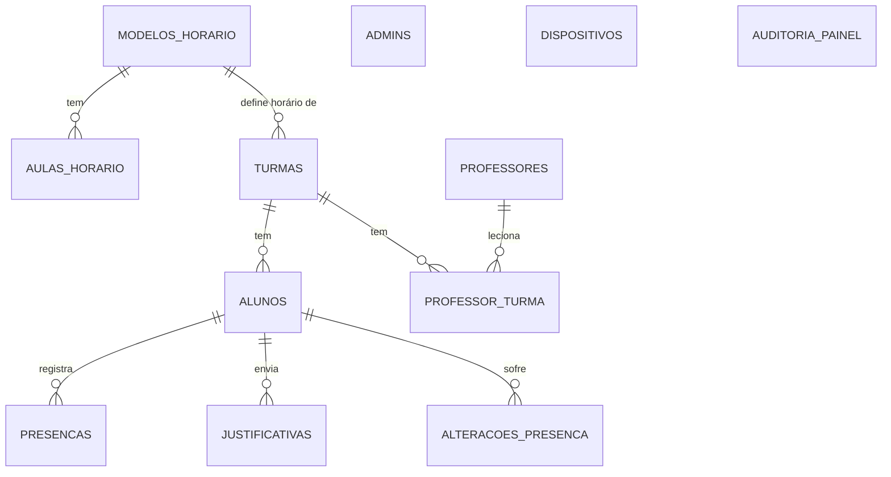

# FrequencyON: dossiê técnico do projeto (para a monografia)

> **Para quem vai editar a monografia:** este arquivo descreve o sistema **como ele está no código hoje** (19/11/2026, branch `ajustes-de-bugs-que-ocorrem`, 56 commits desde 01/10/2026).
>
> - **Atualize o texto antigo.** Se a monografia disser algo diferente deste dossiê, o dossiê é o correto. Exemplos de texto antigo: webcam ligada ao servidor, totem sem prova de vida, fotos públicas, sem HTTPS, sem CSRF, horários fixos de 07:00 a 14:30, 10 aulas sempre.
> - **Não invente.** Não acrescente números, testes ou resultados que não estejam aqui.
> - **Códigos de requisito.** Os códigos RF/RNF citados vêm de comentários no código-fonte. A numeração completa dos requisitos é a da própria monografia.

---

## 1. Identificação

| Item | Valor |
|---|---|
| Nome | **FrequencyON** |
| Slogan | "A chamada que se faz sozinha." |
| Tipo | Sistema web (MVP) de registro de frequência escolar por reconhecimento facial |
| Autor | Gustavo Lopes Zampiron (TCC) |
| Repositório | github.com/ZAMPIRON/tcc-frequencyon |
| Contexto de uso | Escola técnica (cursos Técnico e CAI, estilo SENAI), turmas como "C13", "C12" |
| Licença | Nenhuma ainda (todos os direitos reservados) |

## 2. Problema e justificativa

- A chamada manual consome minutos de toda aula e depende da atenção do professor.
- A lista de papel não vira informação: ninguém soma as faltas a tempo de agir.
- A evasão é percebida tarde, quando o aluno já deixou de frequentar.

## 3. Objetivos

**Geral:** automatizar o registro de presença por reconhecimento facial e transformar os registros em informação para prevenir a evasão.

**Específicos:**
1. Registrar a presença sem esforço, com o aluno passando em frente a um **totem** (tablet com câmera) na entrada.
2. Impedir fraude por foto impressa com **prova de vida passiva**.
3. Dar ao professor uma chamada já preenchida e corrigível aula por aula.
4. Dar ao aluno o acompanhamento da própria frequência e a justificativa de faltas online.
5. Dar à coordenação indicadores, relatórios (Excel/PDF), a lista de **risco de evasão** (< 75%) e alertas por e-mail.
6. Tratar os dados biométricos de acordo com a LGPD: processamento local, consentimento, segurança e auditoria.

## 4. Perfis de usuário (atores)

| Perfil | Login | O que faz |
|---|---|---|
| **Aluno** | matrícula (ou e-mail) + senha | Vê a frequência (anel com situação Regular/Atenção/Crítico) e o histórico aula por aula com filtro de faltas e atrasos. Exporta CSV. Justifica faltas e acompanha o status. Vê um aviso quando a frequência se aproxima do mínimo. |
| **Professor** | e-mail + senha | Usa um calendário do mês colorido pela frequência da turma. Faz e corrige a chamada (clique alterna presente/falta, botão direito marca atraso). Dias anteriores só podem ser alterados com a senha de um administrador. Libera o totem todo dia, com o rosto ou com e-mail e senha. |
| **Administrador (coordenação)** | e-mail + senha | Cadastra alunos (com foto, que vira o rosto), professores (com rosto opcional), turmas, vínculos professor-turma-dias, modelos de horário e totens. Acompanha painel, relatórios, risco de evasão e auditoria. Aceita ou recusa justificativas. Envia alertas e faz backup na hora. |
| **Totem** | sem login; aparelho ativado por código | Tablet em modo quiosque na página `/totem`. Reconhece o aluno e registra a presença. Permite o cadastro de rosto pelo próprio aluno (matrícula + senha). |

## 5. Requisitos

### 5.1 Requisitos citados no código (códigos usados pelo projeto)

| Código | Onde aparece | Conteúdo |
|---|---|---|
| RF13 | `rotas/totem.py`, `templates/totem/reconhecimento.html` | **Fila offline.** Sem rede, o tablet guarda no navegador as fotos tiradas quando há movimento e envia quando a conexão volta. O servidor reconhece cada foto com o horário em que ela foi tirada. |
| RF17 / RNF14 | `rotas/auditoria.py` | **Trilha de auditoria.** Registra toda alteração no painel e toda mudança manual na chamada: quem fez, quando e se foi usada a senha do administrador. |
| RF19 | `rotas/relatorios.py` | **Relatório em PDF** (ReportLab). |
| RF20 | `database.py`, `email_service.py`, `tarefas.py`, `rotas/admin.py`, `templates/aluno/detalhes.html` | **Alerta de frequência baixa.** Abaixo de 80% o aluno vê um aviso no portal e recebe e-mail, no máximo 1 por semana. Professores da turma e admins recebem um resumo. O servidor envia sozinho a cada 6 h, e o admin pode enviar na hora. |
| RNF09 | `database.py` | **Escalabilidade.** Cache do número de "dias com chamada" por turma, invalidado sempre que uma presença entra ou sai do banco. |
| RNF10 | `tarefas.py`, `rotas/admin.py` | **Backup.** Diário e automático em `instance/backups`, com os últimos 30 guardados. Também pode ser feito na hora pelo painel. Usa a API de backup do SQLite, segura com o sistema em uso. |
| RNF11 | `rotas/api.py` | **API REST somente leitura** para integração com o sistema de gestão (ERP) da escola. |
| RNF16 | `tarefas.py`, `email_service.py`, `rotas/api.py` | **Monitoramento.** Um totem liberado que para de enviar imagens por 10 min gera e-mail para a coordenação. A rota `/api/v1/saude` devolve HTTP 503 se algo estiver fora do ar, para ferramentas como UptimeRobot ou Zabbix. |

### 5.2 Requisitos funcionais implementados (lista completa, derivada do código)

1. Login separado para aluno, professor e admin. Logout.
2. CRUD de alunos (com foto, encoding facial, turma, número de chamada, e-mail).
3. CRUD de professores (departamento, rosto opcional para liberar o totem).
4. CRUD de turmas. Vínculo de vários professores por turma, cada um com seus dias da semana. Adicionar e remover alunos da turma.
5. CRUD de modelos de horário: aulas com início, fim e período; tolerância de presente e de atraso; antecedência de abertura do totem.
6. CRUD de totens: código de ativação, novo código, remoção.
7. Ativação do tablet como totem por código de 8 caracteres.
8. Liberação diária do totem por um professor (rosto ou e-mail/senha), válida até 23:59.
9. Reconhecimento facial com prova de vida e registro automático da presença por período.
10. Cadastro do rosto pelo próprio aluno no totem (matrícula + senha).
11. Fila offline no totem (RF13).
12. Chamada do professor: visualização e correção por aula. Dias anteriores exigem a senha de um admin.
13. Calendário mensal colorido pela frequência da turma.
14. Portal do aluno: frequência, histórico, exportação CSV, justificativa de faltas.
15. Fluxo de justificativa: pendente → aceita/recusada, com e-mail para a coordenação.
16. Painel do admin com indicadores, gráfico de frequência por curso e turmas com menor frequência.
17. Relatórios com qualquer intervalo de datas: tendência mensal, por curso e por professor. Exportação em Excel com abas Resumo, Alunos, Turmas, Professores, Em risco e Justificativas, e em PDF (RF19).
18. Lista de risco de evasão (< 75%) e envio de alertas (RF20).
19. Auditoria (RF17/RNF14).
20. Backup (RNF10).
21. API REST (RNF11) e verificação de saúde (RNF16).
22. Troca de senha por linha de comando (`trocar_senha.py`).

### 5.3 Requisitos não funcionais atendidos

- **Desempenho:** o reconhecimento roda em um processo separado (multiprocessing), então o site não trava.
  - O detector HOG roda em todo frame, porque é barato. O encoding (a rede neural, cerca de 0,6 a 1,2 s no notebook do projeto) roda em 2 processos auxiliares (`FACE_TRABALHADORES`), então a detecção e a prova de vida não param enquanto ele é calculado. Enquanto um encoding está em andamento, o HOG roda só a cada 0,5 s e a última caixa é reaproveitada.
  - Tempo medido no notebook do projeto: o aluno é registrado em 0,6 a 0,7 s depois de aparecer na câmera (sem contar a piscada); o próximo da fila, em até cerca de 2 s.
  - Os encodings ficam em memória numa matriz NumPy, e a comparação é vetorizada.
- **Escalabilidade:** cache de dias com chamada (RNF09). O banco pode ser trocado via `DATABASE_URL`.
- **Disponibilidade:** fila offline, backup diário, monitoramento dos totens e rota de saúde.
- **Segurança e privacidade:** ver a seção 10.
- **Usabilidade:**
  - Tema claro e escuro, Bootstrap 5.
  - O totem pode ser instalado como app no tablet (`manifest-totem.json`).
  - Feedback visual e sonoro no registro (confete e som).
- **Portabilidade:** Python puro, roda em Windows, Linux e macOS. Para Windows, o repositório traz o dlib pré-compilado.
- **Fuso horário:** `America/Sao_Paulo`.

## 6. Arquitetura

Padrão **cliente-servidor web monolítico** em Flask, com blueprints por área e um **processo separado** para a visão computacional.

```
Tablet (navegador, câmera)  --frames JPEG (HTTPS)-->  Rotas do totem (Flask)
                                                       |
                                                       v
                               face_service.py (processo separado: dlib/HOG, encoding 128-d, prova de vida)
                                                       |
                                                       v
                                          SQLite (via SQLAlchemy ORM)
                                                       ^
        Professor / Aluno / Admin (navegador) <--> App Flask (rotas/*.py)  --> API REST /api/v1
                                                       ^
                       tarefas.py (thread em segundo plano: alertas, backup, totens) --> SMTP (e-mails)
```

Fluxo do registro:
1. O tablet captura a câmera pelo navegador (`getUserMedia`, que exige HTTPS) e envia alguns frames por segundo para `POST /api/totem/frame`.
2. O servidor reduz o frame e entrega ao processo de reconhecimento.
3. O processo detecta o rosto (HOG), confere a prova de vida, calcula o encoding de 128 números e compara com os alunos cadastrados.
4. Com a pessoa confirmada e viva, `registrar_presenca_totem()` grava as aulas do período atual.
5. O tablet recebe o evento e mostra nome, foto e status.
6. Professor, aluno e coordenação leem **os mesmos registros**, então todas as telas mostram os mesmos números.

Há também um modo de desenvolvimento, `TOTEM_FONTE=camera`, em que a webcam fica ligada ao servidor e o vídeo é servido em MJPEG por `/video_feed`. O padrão é `tablet`.

## 7. Tecnologias

| Camada | Tecnologia | Papel |
|---|---|---|
| Linguagem | Python 3.14 | Todo o back-end |
| Framework web | Flask 3.1 (`flask>=3.0`) | Rotas, sessões, templates |
| ORM | Flask-SQLAlchemy 3.1 (SQLAlchemy 2) | Modelos e consultas |
| Banco | SQLite (arquivo `instance/frequencyon.db`) | Persistência; aceita qualquer URL SQLAlchemy |
| CSRF | Flask-WTF 1.2 | Token CSRF em formulários e POST via JS |
| Visão computacional | OpenCV (`opencv-python`) | Decodificar JPEG, redimensionar, desenhar, stream |
| Reconhecimento facial | `face_recognition` + dlib (`dlib-bin`, `face_recognition_models`) | Detector HOG, 68 landmarks, encoding ResNet de 128 dimensões |
| Cálculo | NumPy | Distância euclidiana vetorizada; EAR (abertura dos olhos) |
| Excel | openpyxl | Relatório da coordenação |
| PDF | ReportLab | Relatório em PDF |
| HTTPS | `cryptography` | CA local e certificado do servidor gerados pelo sistema |
| Senhas | Werkzeug (`generate_password_hash`) | Hash com salt (scrypt/pbkdf2) |
| E-mail | `smtplib` / `email` (biblioteca padrão) | SMTP com SSL (465) ou STARTTLS (587) |
| Front-end | Jinja2, Bootstrap 5.3, JavaScript puro, Chart.js 4 | Telas, gráficos, tema claro/escuro |
| Totem offline | Armazenamento do navegador + `sincronizacao.js` | Fila de fotos sem rede |

## 8. Banco de dados

SGBD: **SQLite**, acessado pelo ORM SQLAlchemy. **12 tabelas.** As migrações são feitas por funções em `database.py` (`migrar_professor_turma`, `migrar_dispositivos`, `migrar_horarios`), que adicionam colunas a bancos antigos sem perder dados.

### 8.1 Dicionário de dados

**admins**: usuários da coordenação

| Coluna | Tipo | Restrição | Descrição |
|---|---|---|---|
| id | INTEGER | PK | |
| nome | VARCHAR(120) | NOT NULL | |
| email | VARCHAR(120) | UNIQUE, NOT NULL | login |
| senha_hash | VARCHAR(255) | NOT NULL | hash Werkzeug |
| foto | VARCHAR(255) | | URL da foto |

**professores**

| Coluna | Tipo | Restrição | Descrição |
|---|---|---|---|
| id | INTEGER | PK | |
| nome | VARCHAR(120) | NOT NULL | |
| email | VARCHAR(120) | UNIQUE, NOT NULL | login |
| senha_hash | VARCHAR(255) | NOT NULL | |
| departamento | VARCHAR(120) | | ex.: TI, Matemática |
| foto | VARCHAR(255) | | |
| face_encoding | BLOB | | 128 float64 (1024 bytes); rosto que libera o totem |

**turmas**

| Coluna | Tipo | Restrição | Descrição |
|---|---|---|---|
| id | INTEGER | PK | |
| nome | VARCHAR(120) | NOT NULL | ex.: C13 (turmas com o mesmo nome aparecem agrupadas) |
| curso | VARCHAR(120) | NOT NULL | ex.: Desenvolvimento de Sistemas 1 |
| modelo_id | INTEGER | FK → modelos_horario.id | horário do dia da turma |

**professor_turma**: associação N:N com atributo

| Coluna | Tipo | Restrição | Descrição |
|---|---|---|---|
| professor_id | INTEGER | PK, FK → professores.id | |
| turma_id | INTEGER | PK, FK → turmas.id | |
| dias | VARCHAR(20) | NOT NULL, default "" | dias da semana em que ESSE professor dá aula NESSA turma, ex.: "1,3" = terça e quinta (0 = segunda … 5 = sábado) |

**alunos**

| Coluna | Tipo | Restrição | Descrição |
|---|---|---|---|
| id | INTEGER | PK | |
| nome | VARCHAR(120) | NOT NULL | |
| email | VARCHAR(120) | | para alertas |
| matricula | VARCHAR(30) | UNIQUE, NOT NULL, índice | login |
| numero_chamada | INTEGER | | |
| senha_hash | VARCHAR(255) | NOT NULL | |
| foto | VARCHAR(255) | | URL em /static/uploads (acesso protegido) |
| face_encoding | BLOB | | 128 float64: o que o reconhecimento usa |
| turma_id | INTEGER | FK → turmas.id | aluno pertence a 0 ou 1 turma |
| alerta_enviado_em | DATETIME | | último e-mail de frequência baixa (evita repetir antes de 7 dias) |

**presencas**: uma linha por aluno, por dia, por aula

| Coluna | Tipo | Restrição | Descrição |
|---|---|---|---|
| id | INTEGER | PK | |
| aluno_id | INTEGER | FK → alunos.id, NOT NULL, índice | |
| data | DATE | NOT NULL, índice | |
| aula | INTEGER | NOT NULL | índice da aula no horário (0 = 1ª aula) |
| status | VARCHAR(10) | NOT NULL | `presente` / `atraso` / `falta` |
| origem | VARCHAR(10) | default "totem" | `totem` / `professor` |
| registrado_em | DATETIME | default agora | |
| — | | **UNIQUE(aluno_id, data, aula)** | impossível duplicar a mesma aula |

**justificativas**

| Coluna | Tipo | Restrição | Descrição |
|---|---|---|---|
| id | INTEGER | PK | |
| aluno_id | INTEGER | FK → alunos.id, NOT NULL, índice | |
| data | DATE | NOT NULL | dia justificado |
| motivo | TEXT | NOT NULL | |
| status | VARCHAR(10) | NOT NULL, default "pendente" | `pendente` / `aceita` / `recusada` |
| criada_em | DATETIME | | |
| respondida_em | DATETIME | | |
| — | | **UNIQUE(aluno_id, data)** | uma justificativa por dia por aluno |

**modelos_horario**: grade do dia, compartilhada por várias turmas

| Coluna | Tipo | Restrição | Descrição |
|---|---|---|---|
| id | INTEGER | PK | |
| nome | VARCHAR(80) | UNIQUE, NOT NULL | ex.: "Técnico (10 aulas de 45 min)" |
| tolerancia_presente | INTEGER | NOT NULL, default 0 | minutos após o início da aula ainda contando como presente |
| tolerancia_atraso | INTEGER | NOT NULL, default 5 | até aqui conta como atraso; depois, falta nessa aula |
| antecedencia | INTEGER | NOT NULL, default 30 | minutos antes do período em que o totem já aceita o aluno |

**aulas_horario**

| Coluna | Tipo | Restrição | Descrição |
|---|---|---|---|
| id | INTEGER | PK | |
| modelo_id | INTEGER | FK → modelos_horario.id, NOT NULL, índice | |
| inicio | TIME | NOT NULL | |
| fim | TIME | NOT NULL | |
| periodo | VARCHAR(10) | NOT NULL, default "manha" | `manha` / `tarde` / `noite` |

**dispositivos**: tablets autorizados como totem

| Coluna | Tipo | Restrição | Descrição |
|---|---|---|---|
| id | INTEGER | PK | |
| nome | VARCHAR(80) | NOT NULL | ex.: "Tablet da entrada" |
| token_hash | VARCHAR(64) | UNIQUE, NOT NULL, índice | SHA-256 do token guardado no cookie do tablet |
| ativado_em | DATETIME | | vazio = aguardando ativação |
| criado_em | DATETIME | | |
| codigo_hash | VARCHAR(64) | índice | SHA-256 do código de ativação pendente |
| codigo_ate | DATETIME | | validade do código (24 h) |
| ultimo_uso | DATETIME | | último frame recebido (base do aviso de "sem sinal") |
| liberado_ate | DATETIME | | fim do dia em que um professor liberou |
| liberado_por | VARCHAR(120) | | nome de quem liberou |

**alteracoes_presenca**: auditoria da chamada

| Coluna | Tipo | Restrição | Descrição |
|---|---|---|---|
| id | INTEGER | PK | |
| aluno_id | INTEGER | FK → alunos.id, NOT NULL, índice | |
| data | DATE | NOT NULL | |
| aula | INTEGER | NOT NULL | |
| status_anterior | VARCHAR(10) | | vazio = não havia registro |
| status_novo | VARCHAR(10) | NOT NULL | |
| professor_id | INTEGER | **sem FK, de propósito** | o histórico permanece se o professor for excluído |
| professor_nome | VARCHAR(120) | NOT NULL | |
| com_senha_admin | BOOLEAN | NOT NULL, default false | alteração de dia anterior autorizada pelo admin |
| alterado_em | DATETIME | NOT NULL | |

**auditoria_painel**: auditoria do painel

| Coluna | Tipo | Restrição | Descrição |
|---|---|---|---|
| id | INTEGER | PK | |
| usuario_tipo | VARCHAR(10) | NOT NULL | `admin` / `professor` |
| usuario_nome | VARCHAR(120) | NOT NULL | |
| acao | VARCHAR(80) | NOT NULL | ex.: "Cadastrou aluno" |
| detalhe | VARCHAR(500) | NOT NULL | |
| quando | DATETIME | NOT NULL, índice | |

### 8.2 Relacionamentos (MER)



- **Professor ↔ Turma é N:N** pela tabela `professor_turma`, que guarda o atributo `dias`. Os dias de aula da turma são a **união** dos dias de todos os seus professores.
- **Exclusões em cascata:** ao excluir um aluno, saem também as presenças, justificativas e alterações dele. Ao excluir um professor ou uma turma, saem os vínculos.
- **Tabelas independentes:** `admins`, `dispositivos` e `auditoria_painel` não têm chave estrangeira.
- **Biometria:** o rosto é guardado como **vetor de 128 números** (BLOB de 1024 bytes), não como imagem.

### 8.3 Dados atuais do banco (povoado para a apresentação)

| Tabela | Registros |
|---|---|
| admins | 1 |
| professores | 7 |
| turmas | 5 (C13 DS 1, C13 DS 2, C12 Laboratório, C14 Mecatrônica, C15 Eletroeletrônica) |
| professor_turma | 10 |
| alunos | 68 (5 reais com rosto cadastrado + 63 fictícios) |
| presencas | 21.817 (17.799 presente, 211 atraso, 3.807 falta) |
| justificativas | 5 |
| modelos_horario / aulas_horario | 1 / 10 |
| dispositivos | 1 |
| alteracoes_presenca / auditoria_painel | 0 / 1 |

**Horário padrão "Técnico (10 aulas de 45 min)":**
- Manhã: 07:05–07:50, 07:50–08:35, 08:35–09:20, intervalo, 09:40–10:25, 10:25–11:10.
- Tarde: 12:40–13:25, 13:25–14:10, 14:10–14:55, intervalo, 15:10–15:55, 15:55–16:40.

Também existe o modelo "CAI (4 aulas de 60 min)": 07:05–08:05, 08:05–09:05, 09:25–10:25, 10:25–11:25.

## 9. Regras de negócio

### 9.1 Registro pelo totem (`registrar_presenca_totem`)
- Qualquer totem registra qualquer aluno, na turma dele (**totens universais**). A sala não é controlada porque as turmas trocam de sala o tempo todo.
- O dia é dividido em **blocos por período** (manhã, tarde, noite). O aluno passa no totem **uma vez por período**. Quem sai no almoço e não volta fica com falta à tarde.
- O totem abre o bloco `antecedencia` minutos antes da primeira aula (padrão 30) e fecha no fim da última aula.
- Status de cada aula do bloco, calculado na hora da passagem:
  - **falta** se a aula já terminou;
  - **presente** até início + `tolerancia_presente` (padrão 0 min);
  - **atraso** até início + `tolerancia_atraso` (padrão 5 min);
  - depois disso, **falta só naquela aula**, e as seguintes ficam presente.
- Respostas especiais: `sem_aula` (hoje não é dia da turma), `fora_horario` (mostra a hora em que o próximo registro abre ou avisa que as aulas acabaram) e "já registrado".
- Uma aula que o professor já lançou não é sobrescrita pelo totem.
- A restrição UNIQUE resolve a concorrência: se o aluno passar em dois totens ao mesmo tempo, o segundo registro é descartado.

### 9.2 Correção pelo professor
- Clique na barra da aula alterna presente ↔ falta. Botão direito marca atraso.
- A chamada de **hoje** pode ser editada livremente. **Dias anteriores** são somente leitura e só mudam com a senha de um administrador (registrada como `com_senha_admin`). **Dias futuros** não podem ser editados.
- O professor só edita turmas a que está vinculado. Toda alteração vai para `alteracoes_presenca`.

### 9.3 Cálculo da frequência

```
Frequência (%) = aulas com status presente ou atraso
                 ÷ (dias com chamada na turma × aulas por dia do horário da turma) × 100
```

- **Dia com chamada:** dia de aula da turma em que pelo menos um aluno da turma tem registro.
  - Quem não passou pelo totem nesse dia conta como falta.
  - Um feriado sem nenhum registro não prejudica ninguém.
- Só contam os dias da semana da turma. Aulas de um horário antigo mais longo são ignoradas.
- **Atraso conta como presença** no cálculo, mas aparece separado no histórico.
- Faixas de situação: **≥ 75% Regular**, **50–74% Atenção**, **< 50% Crítico**.
- **< 75%** (frequência mínima): o aluno entra no **risco de evasão**.
- **< 80%** (`ALERTA_FREQUENCIA`): o aluno vê um aviso no portal e recebe e-mail, no máximo 1 a cada 7 dias.
- A frequência média da turma é a média dos alunos. A do professor é a média das turmas dele.

### 9.4 Justificativa de faltas
- O aluno só pode justificar um dia que **tem falta** e que ainda não foi justificado, ou cuja justificativa foi recusada (pode reenviar).
- Status: `pendente` → `aceita` ou `recusada`, decidido pelo admin.
- Um e-mail vai para `EMAIL_JUSTIFICATIVAS` com um link para o painel e com o "Responder" apontando para o e-mail do aluno.
- O envio é feito em thread separada, com até 3 tentativas.

### 9.5 Totem: ativação e liberação
1. **Cadastro e ativação.** O admin cadastra o totem e recebe um **código de 8 caracteres**. O alfabeto não tem 0, O, 1 nem I, para evitar confusão. O código vale **24 h** e é de **uso único**. O tablet digita o código uma vez e recebe um token aleatório num cookie; o banco guarda só o SHA-256 dele.
2. **Bloqueio diário.** Todo dia o totem começa **bloqueado**.
3. **Liberação.** Um professor (ou admin) o libera olhando para a câmera, se tiver rosto cadastrado, ou digitando e-mail e senha. O totem fica liberado até 23:59 e se bloqueia sozinho.
4. **Limite de tentativas.** 10 tentativas erradas por IP em 15 min bloqueiam a liberação e a ativação.
5. **Estados no painel:** aguardando ativação, liberado hoje (por quem), bloqueado, último uso e aviso de "sem sinal". Um tablet perdido pode ser desativado e pode receber um novo código.

### 9.6 Cadastro do rosto
- **Pelo admin:** foto enviada no cadastro do aluno. A foto precisa ter **exatamente 1 rosto**, senão é rejeitada.
- **Pelo totem:** o aluno digita matrícula e senha, e o sistema faz **até 5 capturas** e grava a **média dos encodings**, que é mais estável que uma foto só. 5 senhas erradas bloqueiam a matrícula por 15 min.
- **Professor:** rosto cadastrado pelo admin, usado só para liberar o totem.

## 10. Reconhecimento facial (`face_service.py`)

| Etapa | Técnica | Parâmetro |
|---|---|---|
| Detecção | HOG (Histogram of Oriented Gradients) do dlib | rosto mínimo de 40 px de altura no frame reduzido; se houver vários, usa o maior (o mais perto) |
| Rastreamento | IoU entre caixas de frames seguidos | ≥ 0,4 é o mesmo rosto; mais de 5 s sem ver ninguém reinicia a trilha |
| Landmarks | 68 pontos do dlib | olhos e lábios para a prova de vida |
| Encoding | rede ResNet do dlib (via `face_recognition`) | vetor de 128 dimensões |
| Comparação | distância euclidiana contra todos os cadastrados (NumPy vetorizado) | aceita se ≤ **0,50** |
| Confirmação | mesmo aluno em **2 encodings seguidos**, ou 1 só se a distância for ≤ **0,42** | |
| Reverificação | rosto já reconhecido é conferido de novo a cada 1,5 s (e logo após a pausa depois de um registro); se a pessoa trocou, recomeça | |
| Ritmo | um encoding por rosto de cada vez, em processo auxiliar; rosto desconhecido: nova tentativa a cada 0,5 s | |
| Cooldown | o mesmo aluno não é processado de novo por **8 s**; pausa de **0,5 s** após cada registro | |
| Frame velho | um frame com mais de 2 s é descartado | |

**Prova de vida por piscada (anti-spoofing):**
- **Medida:** a cada frame o sistema calcula o **EAR (Eye Aspect Ratio)** dos dois olhos, que fica perto de 0,3 aberto e de 0,1 fechado.
- **Janela:** são guardados os últimos 8 frames.
- **Critério de vida:** o rosto é considerado **vivo** quando o aluno **pisca**, nesta ordem: olhos abertos (EAR ≥ 0,20), olhos fechados (a abertura cai pelo menos **30%**, `VARIACAO_VIVO`) e olhos abertos de novo (voltam a pelo menos 85% da abertura de antes). Exigir que o olho reabra impede que uma foto inclinada, em que a abertura medida cai e fica baixa, conte como piscada.
- **Por que 30%:** num teste com 11 fotos simulando uma foto impressa (parada, com tremor leve, médio e forte, ruído e compressão JPEG), a abertura medida dos olhos oscilou 10 a 20% só por ruído. Com o limite antigo de 12%, a maioria das fotos passava; com 30%, nenhuma passou. Uma piscada real derruba a abertura em 40 a 70%.
- **Foto impressa:** não pisca e não é aceita. Enquanto não houver vida, a tela pede **"Pisque os olhos"** (estado `pisque`) desde o momento em que o rosto aparece, para a piscada acontecer enquanto o encoding é calculado.
- **Desligar:** `PROVA_DE_VIDA=0` desliga a prova de vida, só para testes.

**Estados que o totem mostra:** `sem_rosto`, `longe`, `verificando`, `desconhecido`, `pisque`, `ok`. Depois do registro aparecem presente, atrasado, fora do horário, sem aula ou já registrado.

**Arquitetura do processamento:**
- **Processo separado:** o reconhecimento roda num processo do sistema operacional (`multiprocessing`) que recebe frames por fila. Cada totem tem sua própria "trilha", então vários totens funcionam ao mesmo tempo.
- **Grupos de rostos:** há dois conjuntos de cadastrados, `aluno` (totem liberado, registra presença) e `prof` (totem bloqueado, liberação).
- **Atualização:** os encodings são recarregados no processo sempre que um cadastro muda.

**Por que HOG e não CNN:** o HOG roda bem em CPU comum, sem placa de vídeo, que é a realidade das escolas. A CNN é mais precisa, mas muito mais pesada.

## 11. Segurança e privacidade (LGPD)

O sistema trata **dados biométricos**, que a LGPD (art. 5º, II) classifica como dados pessoais sensíveis, de alunos que em muitos casos são **menores de idade**. Medidas implementadas:

- **Processamento local:** nenhuma imagem é enviada a serviços externos.
- **Minimização:** o reconhecimento usa só o vetor de 128 números. A foto serve apenas como imagem de perfil.
- **Acesso às fotos:** os arquivos de `static/uploads` só abrem para usuários logados ou para um totem ativado. Os nomes de arquivo são aleatórios (UUID).
- **HTTPS por padrão (TLS):**
  - O sistema gera uma **autoridade certificadora local**, restrita a localhost, ao nome do computador e a IPs privados.
  - O certificado do servidor é renovado sozinho quando vence ou quando o IP muda.
  - O HTTP só redireciona para HTTPS.
  - O HSTS é ativado quando há um certificado real.
- **CSRF** (Flask-WTF) em todos os formulários e POSTs em JavaScript.
- **Cookies de sessão** `Secure`, `HttpOnly` e `SameSite=Lax`.
- **Senhas:** guardadas como hash com salt (Werkzeug).
  - A lista de senhas fracas é bloqueada, e o servidor avisa no terminal quais contas ainda usam senha padrão.
  - A troca de senha é feita por `trocar_senha.py`.
  - A senha inicial do admin é aleatória e aparece uma vez no terminal.
- **Força bruta:**
  - Login: 10 erros no mesmo login a partir do mesmo aparelho bloqueiam por 15 min.
  - Totem: 10 erros por IP em 15 min bloqueiam a liberação e a ativação.
  - Cadastro de rosto no totem: 5 erros bloqueiam a matrícula por 15 min.
- **Totem:** só funciona com código de ativação de uso único, e o banco guarda só os hashes (SHA-256) do token e do código. A liberação diária precisa de um professor.
- **Prova de vida** contra foto impressa.
- **Auditoria** de toda alteração no painel e na chamada.
- **Segredos fora do Git:** `.env`, `instance/` (banco, chave secreta, certificados, backups) e `static/uploads/` estão no `.gitignore`.
- **API:** somente leitura, com token Bearer. Nunca devolve senha, foto ou biometria, e fica desligada se o token estiver vazio.
- **Consentimento:** o repositório traz o modelo `docs/Termo_Consentimento_LGPD_FrequencyON.docx`.

## 12. Rotas (endpoints)

**Acesso:** `/` (página inicial), `/login/aluno`, `/login/professor`, `/login/admin`, `/logout`.

**Admin (`/admin`):**
- Painel: `/dashboard`.
- Alunos: `/alunos`, `/alunos/novo`, `/alunos/<id>`, `/alunos/<id>/editar`, `/alunos/<id>/exportar`, `/alunos/<id>/deletar`, `/alunos/<id>/desvincular`.
- Professores: `/professores`, `/professores/<id>/editar`, `/professores/<id>/rosto`, `/professores/<id>/deletar`.
- Turmas: `/turmas`, `/turmas/<id>`, `/turmas/<id>/editar`, `/turmas/<id>/deletar`, `/turmas/<id>/adicionar`, `/turmas/<id>/horario`, `/turmas/<id>/professores` (vincular, alterar dias, remover).
- Horários: `/horarios`, `/horarios/novo`, `/horarios/<id>`, `/horarios/<id>/remover`.
- Justificativas: `/justificativas/<id>/<aceita|recusada>`.
- Totens: `/totens`, `/totens/novo`, `/totens/<id>/codigo`, `/totens/<id>/remover`.
- Acompanhamento: `/relatorios`, `/relatorios/exportar` (Excel), `/relatorios/pdf`, `/risco-evasao`, `/alertas`, `/backup`, `/auditoria`.

**Professor (`/professor`):** `/chamada`, `/toggle/<aluno>/<aula>`, `/atraso/<aluno>/<aula>`.

**Aluno (`/aluno`):** `/` (painel), `/exportar` (CSV), `/justificar`.

**Totem:**
- Telas e ativação: `/totem`, `/totem/ativar`.
- Liberação: `/totem/liberar/frame`, `/totem/liberar`.
- Reconhecimento: `/api/totem/frame`, `/api/totem/offline` (fila offline), `/api/reconhecimento`.
- Cadastro de rosto: `/api/cadastrar_foto`.
- Modo câmera no servidor: `/video_feed`.

**API REST (`/api/v1`, Bearer token, somente GET):**

| Rota | Retorno |
|---|---|
| `/turmas` | turmas |
| `/alunos` | alunos |
| `/frequencia?inicio=AAAA-MM-DD&fim=AAAA-MM-DD` | frequência no período |
| `/alunos/<id>/presencas` | presenças de um aluno |
| `/saude` | situação do banco, do reconhecimento e dos totens (503 se houver falha) |

## 13. Tarefas em segundo plano (`tarefas.py`)

Uma thread que roda junto com o servidor e verifica a cada 60 s se alguma tarefa venceu:

| Tarefa | Frequência | O que faz |
|---|---|---|
| Alertas de frequência (RF20) | a cada 6 h | E-mail para alunos abaixo de 80% sem aviso nos últimos 7 dias. Um resumo único vai para os professores da turma e para os admins. |
| Backup (RNF10) | a cada 24 h | Copia o SQLite para `instance/backups/frequencyon-AAAAMMDD-HHMMSS.db` e mantém os 30 mais novos. |
| Totens sem sinal (RNF16) | a cada 5 min | Totem liberado sem frames por 10 min durante a aula gera um e-mail, uma vez por queda. |

Se uma tarefa falha, as outras continuam rodando.

## 14. E-mails (`email_service.py`)
- **Tipos:**
  1. Nova justificativa (para a coordenação).
  2. Alerta de frequência baixa (para o aluno).
  3. Resumo de alunos com frequência baixa (para professores e admins).
  4. Totem sem sinal (para a coordenação).
- **Formato:** HTML com versão em texto.
- **Envio:** em segundo plano, com até 3 tentativas.
- **Configuração:** SMTP no `.env`. No Gmail é preciso usar uma senha de app.

## 15. Telas (34 capturas em `docs/manual/`)

- **Acesso:** 01 página inicial, 02 login do aluno, 03 login do professor, 04 login do administrador, 05 senha incorreta.
- **Admin:**
  - 06 painel;
  - 07 alunos, 08 cadastrar aluno, 09 detalhes do aluno;
  - 10 professores, 11 cadastrar professor;
  - 12 turmas, 13 nova turma, 14 detalhes da turma, 15 vincular professor, 16 adicionar aluno na turma;
  - 17 horários, 18 relatórios, 19 risco de evasão, 20 totens, 21 auditoria.
- **Professor:** 22 chamada do dia, 23 dia anterior (somente leitura), 24 alterar dia anterior (senha do admin).
- **Aluno:** 25 minha frequência, 26 justificar falta.
- **Totem:** 27 ativar, 28 bloqueado, 29 aguardando aluno, 30 verificando (prova de vida), 31 presença confirmada, 32 cadastrar rosto.
- **E-mails:** 33 justificativa, 34 alerta de frequência.

**Menu lateral do admin:** Painel, Alunos, Professores, Turmas, Horários, Relatórios, Risco de evasão, Totens, Auditoria.

## 16. Estrutura do código

| Arquivo | Linhas | Responsabilidade |
|---|---|---|
| app.py | 169 | `create_app()`, configuração, HTTPS, proteção das fotos, início do servidor |
| database.py | 578 | Modelos, regras de presença e horários, cálculo de frequência, migrações |
| face_service.py | 644 | Reconhecimento, prova de vida, processo separado, fila offline |
| email_service.py | 192 | Leitura do `.env`, montagem e envio de e-mails |
| tarefas.py | 150 | Alertas, backup, monitoramento dos totens |
| certificado.py | 128 | CA local e certificado HTTPS |
| seed.py / trocar_senha.py | 91 / 43 | Dados de demonstração (apaga o banco) / troca de senha |
| rotas/admin.py | 600 | Cadastros, horários, totens, justificativas |
| rotas/totem.py | 353 | Ativação, liberação, frames, fila offline, cadastro de rosto |
| rotas/relatorios.py | 330 | Relatórios, Excel, PDF |
| rotas/professor.py | 255 | Chamada e calendário |
| rotas/aluno.py | 146 | Portal do aluno, CSV, justificativa |
| rotas/api.py | 118 | API REST e saúde |
| rotas/auditoria.py | 94 | Trilha de auditoria |
| rotas/login.py / comum.py | 71 / 62 | Logins / utilidades (login obrigatório, upload) |

Total: cerca de 4.800 linhas de Python, mais templates Jinja (admin, professor, aluno, totem, componentes), 8 arquivos CSS e 6 de JavaScript.

## 17. Instalação e execução

```bash
python -m venv .venv && .venv\Scripts\activate          # Windows
pip install dlib-20.0.99-cp314-cp314-win_amd64.whl       # só no Windows
pip install -r requirements.txt
python app.py
```

- **Endereços:** o sistema fica em `https://localhost:5443` e o totem em `/totem`. A porta 5000 (HTTP) redireciona para HTTPS. Outros aparelhos da rede acessam pelo IP mostrado no terminal.
- **Certificado:** instale a CA `instance/ca-frequencyon.pem` uma vez em cada aparelho, porque o navegador só libera a câmera em HTTPS.
- **Principais variáveis do `.env`:**
  - Totem e câmera: `TOTEM_FONTE`, `PROVA_DE_VIDA`, `VARIACAO_VIVO`.
  - Servidor: `HTTPS`, `PORTA_HTTPS`, `DATABASE_URL`.
  - Frequência e horários: `ALERTA_FREQUENCIA`, `TOLERANCIA_PRESENTE`, `TOLERANCIA_ATRASO`, `ANTECEDENCIA_TOTEM`.
  - Monitoramento e backup: `TOTEM_SEM_SINAL`, `BACKUPS_GUARDADOS`.
  - API: `FREQUENCYON_API_TOKEN`.
  - E-mail: `EMAIL_JUSTIFICATIVAS`, `SMTP_*`.
  - Testes: `FREQUENCYON_DATA`, que congela a data de "hoje".

## 18. Limitações e trabalhos futuros

**Limitações atuais (honestas):**
- A prova de vida é passiva (movimento de olhos e boca). Ela recusa foto impressa, mas um vídeo em tela pode passar.
- A precisão cai com pouca luz, máscara ou ângulo ruim.
- O HOG é menos preciso que uma CNN.
- O SQLite atende uma escola. Para várias escolas, seria preciso PostgreSQL.
- Não há testes automatizados versionados no repositório.
- A licença ainda não foi definida.
- O consentimento LGPD depende da escola coletar os termos.

**Trabalhos futuros:**
- Anti-spoofing mais robusto: detecção de tela e vídeo, profundidade.
- Modelo CNN quando houver GPU.
- Aviso aos responsáveis quando a frequência cair.
- Várias escolas na mesma instalação (multi-tenant), PostgreSQL e Docker.
- Interface em inglês e espanhol.
- Integração com sistemas de gestão escolar e plataformas de ensino.
- Relatórios para secretarias de educação.

## 19. Histórico do desenvolvimento

De 01/10/2026 a 19/11/2026, 56 commits no Git. Etapas, pelas mensagens de commit:

| Data | O que foi feito |
|---|---|
| 01/10 | Primeiro commit e primeira versão |
| 08/10 | Back-end pronto. Totem, telas do professor (calendário) e do aluno. Presença a partir da aula em que chegou, em vez de falta no dia todo. Gráficos. Primeiro README. Justificativa de faltas. |
| 14/10 | Envio de e-mail funcionando. Rotas divididas em arquivos (blueprints). |
| 15/10 | Telas de login. Foto de perfil recortada pelo totem. Encoding mais leve. **Segurança:** cadastro de rosto pede senha, fotos fora do Git, chave secreta, senhas no `.env`, `trocar_senha.py`, CSRF, **HTTPS**. **Termo de consentimento LGPD.** |
| 22/10 | Testes no totem, mudanças no reconhecimento, totem em tela cheia |
| 29/10 | Totem criado pelo admin e atribuído a uma sala. Turmas separadas por sala. |
| 05/11 | Ajuste no funcionamento do totem e das aulas. Correção dos defeitos encontrados nos cenários de teste. |
| 12/11 | Correção de justificativa e novos testes. **E-mails de frequência baixa.** **Separação por salas removida:** os totens viraram universais. |
| 19/11 | Manual técnico (README) atualizado com novas capturas de tela |
